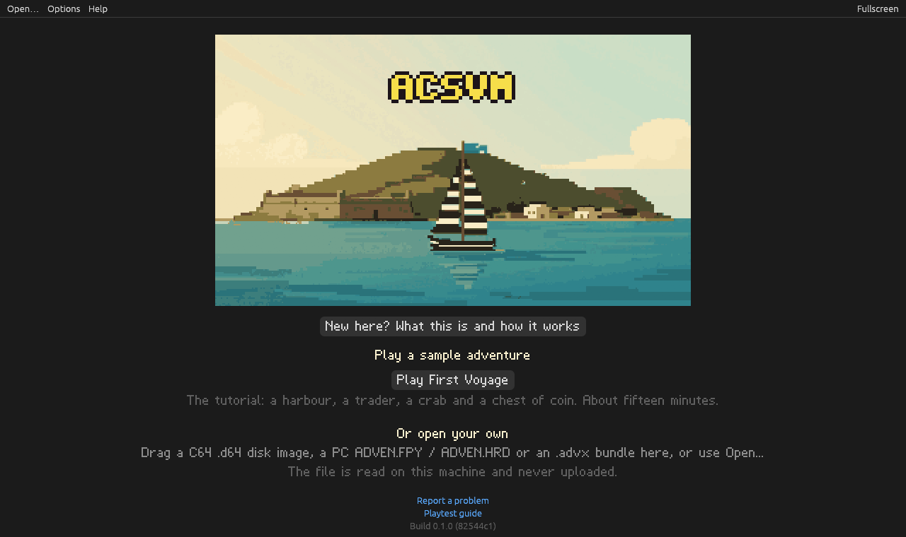
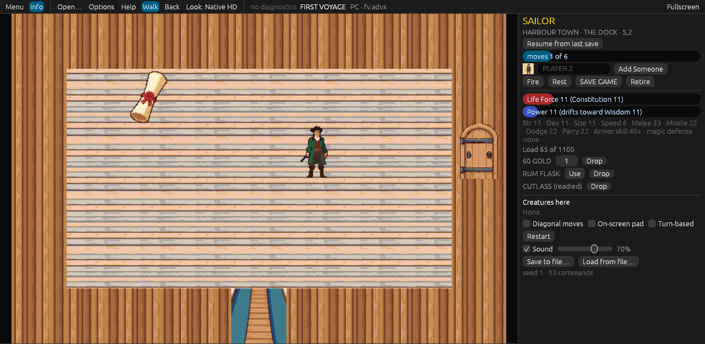
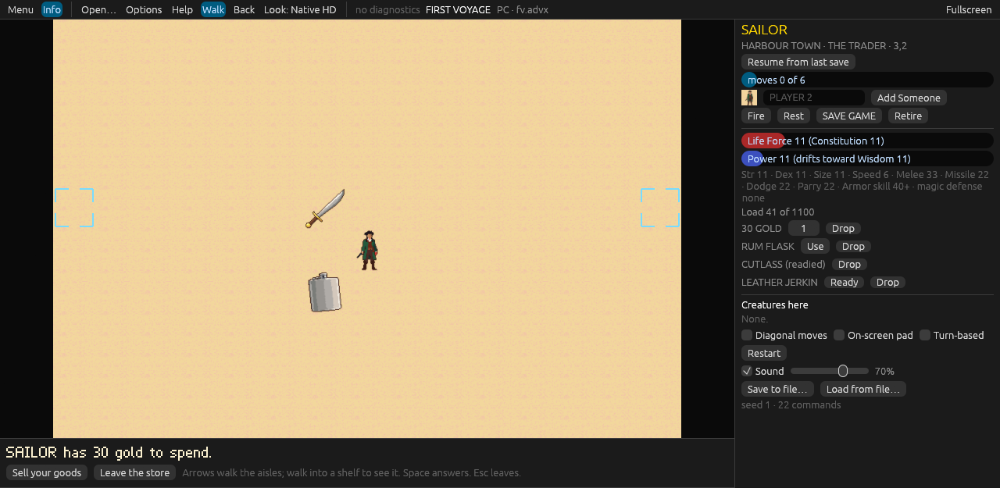
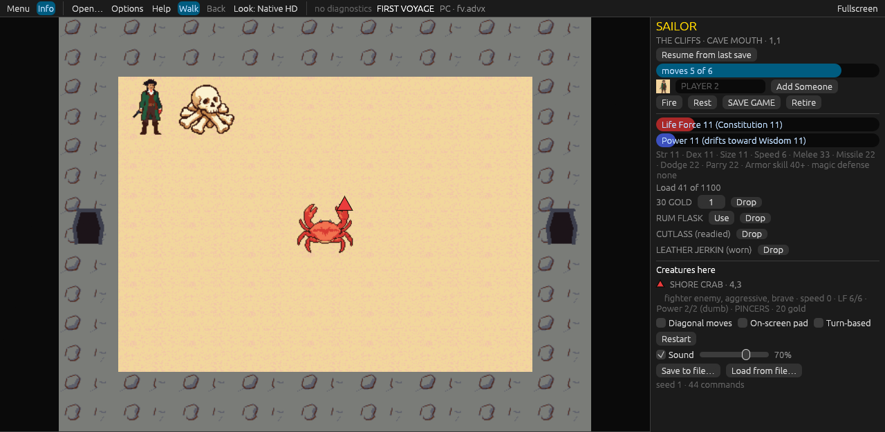
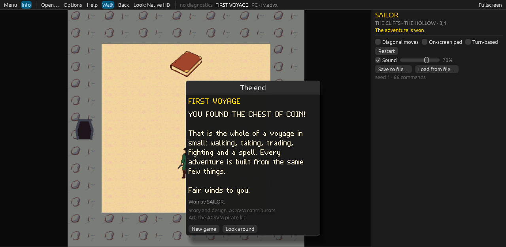
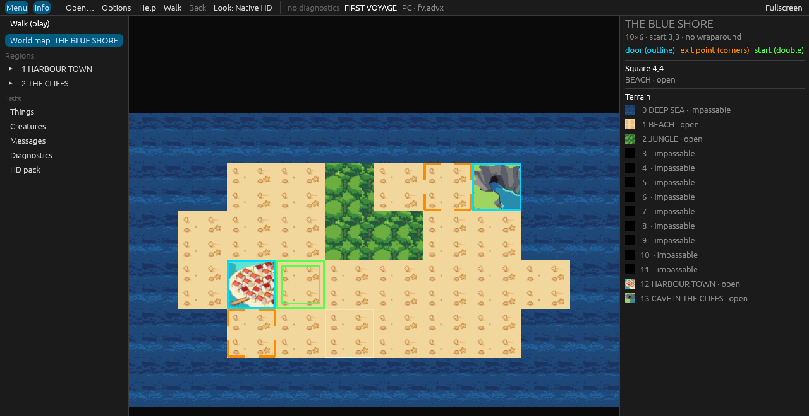

# ACSVM

**Play *Adventure Construction Set* adventures on today's computers, in a
browser or on the desktop.**

[**▶ Play in your browser**](https://dragynrain.github.io/ACSVM/) ·
[Playtest guide](docs/playtest.md) ·
[Report a problem](https://github.com/Dragynrain/ACSVM/issues/new/choose)



In 1984 Electronic Arts released *Adventure Construction Set*, a kit for
building your own tile-based fantasy adventures and playing them with
friends. People made a lot of them, and many still sit on old C64, PC and
Amiga disks. ACSVM is a new, open-source engine that plays those
adventures, much as ScummVM does for LucasArts games: you bring the
adventure files you own, and the engine runs them.

It comes with a short adventure of its own, *First Voyage*, so you can try
it without any old disks.

*ACSVM is a working name. This project has no connection to Electronic
Arts and ships none of EA's code, art, music, manual text or adventures.*

## What it looks like

These screenshots are from *First Voyage*, drawn in our own pirate art.

| | |
| --- | --- |
|  |  |
| **Walking.** Arrow keys, mouse, touch pad or a gamepad. The panel on the right shows your ratings and what you carry. | **Stores.** Walk up to a shelf to see its price, then buy or sell. |
|  |  |
| **Fights.** Every creature in the room is listed with its temper, speed and weapon. | **The end.** *First Voyage* takes about fifteen minutes. |



**Explore** shows an adventure the way its designer built it: the world
map, every region and room, and the lists of things, creatures and
messages.

## What you can do

- **Play the tutorial.** Pick *First Voyage* on the title screen. Notes on
  the way explain moving, taking things, the store, a fight and a spell.
- **Play your own adventures.** Drag a file onto the window, or use
  Open…:
  - a C64 `.d64` disk image
  - a PC `ADVEN.FPY` or `ADVEN.HRD`
  - an Amiga `.adf` disk image

  The file is read on your computer and never uploaded.
- **Play together.** Several players take turns at one keyboard, the way
  the original was played. Up to four gamepads work as well.
- **Save anywhere.** A save file holds only the seed and the moves played,
  so it is tiny, and it replays a game exactly. That also makes it the best
  thing to attach to a bug report.
- **Pick a look.** You can keep the original pixels, smooth them, or load an
  HD pack of new art. A coverage report shows which pictures a pack
  replaces.
- **Make it comfortable.** Larger text, a colour-blind palette, an
  on-screen touch pad, and a turn-based option so the game waits for you.

## How faithful is it?

Each rule (movement, combat, magic, creatures' behaviour, stores,
encounters) is written down in [`docs/rules/`](docs/rules/movement.md)
before it is coded. Most of it was then measured against the real C64
program running in an emulator: we set up a situation, ran it hundreds of
times and compared the results with ours. Where something couldn't be
measured, the rule says so and says what the engine does instead.

As a check on the whole, an automated replay plays EA's own *Rivers of
Light* through to the end with two players.

If something plays differently from what you remember, please tell us. It
is the most useful report we can get.

## Status

All the rules are in, and the desktop and browser versions both work. We
are now running a **public playtest** before 1.0, and we'd especially like
to hear from people who played ACS back in the day:

1. Read the short [playtest guide](docs/playtest.md).
2. Play *First Voyage*, then your own disks.
3. [Open an issue](https://github.com/Dragynrain/ACSVM/issues/new/choose)
   using one of the forms: *Something broke*, *Plays differently from the
   original*, or *Playtest notes*.

Please don't attach saves or screenshots of EA's or other people's
adventures to a public issue. The forms explain how to describe them
instead.

## Supported files

| Platform | Files | Status |
| --- | --- | --- |
| Commodore 64 | `.d64` disk images | Plays. Tested on fan adventures from several collections. |
| PC (MS-DOS) | `ADVEN.FPY`, `ADVEN.HRD` | Plays. Tested on EA's built-in adventure. |
| Amiga | `.adf` disk images | Opens and plays. Newer, and less tested. |
| ACSVM | `.advx` bundles | Our own format for new adventures ([docs/content.md](docs/content.md)) |
| Apple II | `.dsk` | Not yet |

## Running it yourself

The easiest way is the [browser version](https://dragynrain.github.io/ACSVM/),
which needs no installation. To build the desktop viewer you need
[Rust](https://rustup.rs) 1.95 or newer:

```bash
cargo build --release
target/release/acs-viewer            # then drag a file onto the window
target/release/acs-viewer GAME.D64   # or open one straight away
```

[docs/usage.md](docs/usage.md) covers the rest: the controls, the command
line, the `acs` inspector (adventures to JSON, pictures to PNG), building
for the web, and running the tests.

## For the curious

- [docs/design.md](docs/design.md): the plan and how the pieces fit
- [docs/rules/](docs/rules/movement.md): the rules, one file per topic
- [docs/capture.md](docs/capture.md): how the original is measured in the
  VICE emulator
- [docs/content.md](docs/content.md): writing new adventures from text
  files and starter kits
- [CONTRIBUTING.md](CONTRIBUTING.md): how to help, including the
  clean-room policy and the rule that no EA material ever enters the
  repository

## Licenses

- Code: [GPL-3.0-or-later](LICENSE). Parts of the decoder are ported from
  Dan Boris's [ACS Viewer](https://github.com/danlb2000/ACSViewer) (GPL-3.0);
  see [docs/provenance.md](docs/provenance.md).
- Art, audio, our adventures and the screenshots above:
  [CC BY-SA 4.0](LICENSES/CC-BY-SA-4.0.txt).
- Documentation: [CC BY 4.0](LICENSES/CC-BY-4.0.txt).
