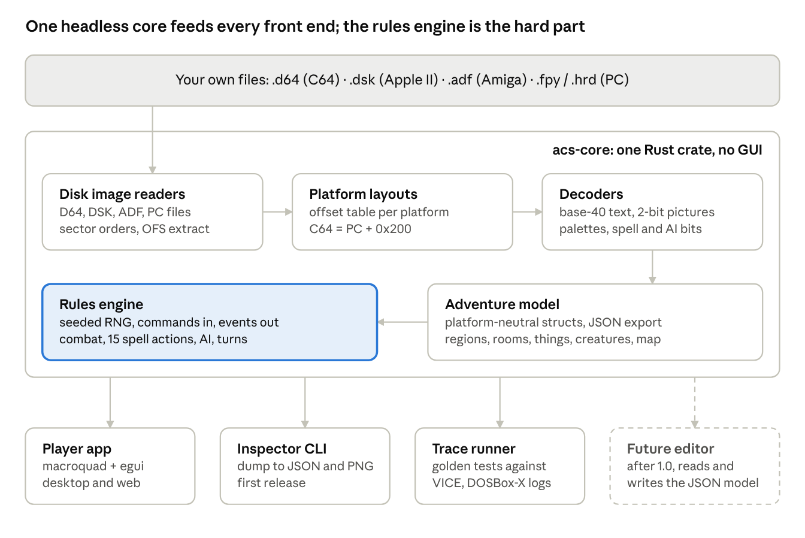
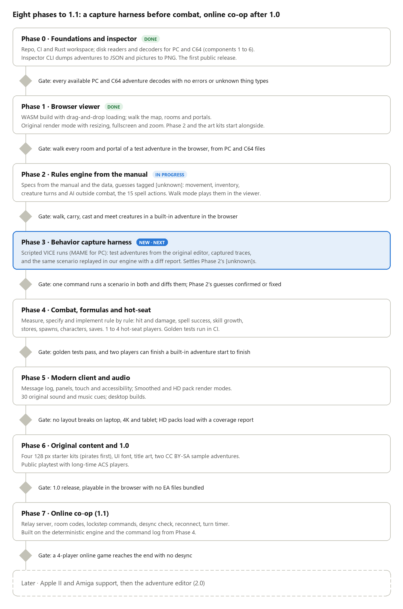

# ACSVM: Open Source Engine Design

> Snapshot of the living design doc: https://claude.ai/artifact/RxNSzwZ9jfzxDfBfCHaVKD (exported 2026-11-10). Diagrams are PNG snapshots in docs/images/. Licensed CC BY 4.0.

Nov 10, 2026 · @Dragyn

## Summary

Build an open-source player that loads existing Adventure Construction Set (ACS) adventure files and runs them faithfully, with modern display, input, saves and accessibility. The player never ships EA code, art or the built-in adventures: users point it at disk images or files they own.

**In scope:** reading ACS adventure data from PC, Apple II, C64 and Amiga releases, a rules engine that matches the original's behavior, a clean renderer at any resolution, keyboard, mouse and gamepad play, save states, 1 to 4 hot-seat players, and original or HD render modes, in the browser first and on desktop too. Online co-op follows in 1.1.

**Non-goals for v1:** an editor (the format layer is built so an editor can come later), online play (1.1) and running the original program code (that is an emulator's job).

## Background

Most of the file format is already mapped. The manual describes how the game plays but gives almost no formulas, so measuring those is most of the new work.

**ACS** (Electronic Arts, 1984, designed by Stuart Smith) was released for the C64, Apple II, MS-DOS and Amiga. Players build tile-based adventures, which are worlds of regions and rooms filled with things and creatures, and then play them alone or hot-seat.

**Prior art:**

- [ACS Viewer](https://github.com/danlb2000/ACSViewer) by Dan Boris: a C# viewer (GPL-3.0, v2.0 from 2020) that reads PC, C64, Apple II and Amiga adventures. It includes a basic walk-through mode. Its `AcsLib` is the most complete record of the format.
- [ACS file format draft v0.5](https://atarihq.com/danb/acs.shtml) (Boris, 2016): 21 pages covering PC and C64 offsets, text encoding, things, creatures, regions and the world map. It says itself that it is incomplete.
- Adventure Creation Kit (Chris Hopkins, 1995, freeware since about 2000): a separate tool inspired by ACS. Nothing found says it reads ACS files. [ack-rol](https://github.com/GarthsEquipmentShop/ack-rol) (2013) rebuilt *Rivers of Light* in it by hand.
- [StefACS](https://aminet.net/package/game/demo/StefACS) by Stefano Maria Regattin (v0.04, January 2023): an early Amiga rewrite of the ACS creator in Blitz2 BASIC, made because the original needs Kickstart 1.2 or 1.3. Its page does not say it reads ACS files.
- [AdventureConstructionSetSaveEditor](https://github.com/thiscouldbebetter/AdventureConstructionSetSaveEditor) (August 2025, work in progress): an editor for the DOS `ADVEN.HRD` file. Its license has not been checked, so nothing from it is used yet.

A survey in November 2026 (GitHub, Aminet, RPG Codex, Quarter To Three, AtariAge, Lemon64, Hacker News) found no player that runs ACS files and no abandoned attempt at one. ACS Viewer's walk-around mode is the closest. Demand is small and mostly nostalgic. The clearest signals are an RPG Codex thread (2018 to 2026) whose archivist keeps hitting broken disk images and unreliable emulators and asks for a site to revive ACS, and a 2006 Quarter To Three wish for a modern ACS that publishes to the web. The risk is less overlap with another project than the pattern of earlier efforts, which stopped once the format worked and before the rules engine.

**How each platform stores an adventure** (from the ACS Viewer README):

| Platform | Container | Notes |
| --- | --- | --- |
| MS-DOS | `ADVEN.FPY` / `ADVEN.HRD` file | Reference layout for every offset in the draft |
| C64 | Whole `.d64` disk | Same layout as PC plus a 0x200-byte header; different graphics encoding |
| Apple II | Whole `.dsk` disk | No directory, so standard disk tools fail |
| Amiga | `Adventure` file inside an `.adf` | ACS Viewer extracts it with the bundled UAEUNP tool |

**Legal approach:** the engine reads files the user supplies. It never bundles EA's program, art or built-in adventures, and it avoids the ACS name and trademark in branding. Facts about a file format can't be copyrighted, but ACS Viewer's code is GPL-3.0. Porting that code means the engine must also be GPL-3.0, which is the recommendation here. When rules are recovered by studying the original program, a clean-room split applies: one person writes a behavior spec, and someone else implements from the spec.

## What the engine must reproduce

The data has a fixed, small shape that fits in well under 200 KB per adventure. The manual describes the rules that act on that data in detail, but almost never with formulas.

### Data model (PC offsets, from Boris's draft)

| Entity | Limit | Key fields |
| --- | --- | --- |
| World map | 40 x 40 tiles, 16 terrain types | Terrain passability: impassable, open, owners of a thing only, or triggers a spell |
| Map portals | 32 | World x,y to a region, room and x,y |
| Regions | 15 | 20-character name, up to 16 rooms, 16 resident and 8 random creatures |
| Rooms | 16 per region | Wall picture, up to 15 x 10 squares, position, random-creature chance (value x 5%) |
| Room items | Variable list per region | x,y (4 bits each), thing number, parameter |
| Things | 128 in the master list | 13 types: floor, treasure, magic item, missile or melee weapon, armor, spell, portal, space, custom space, obstacle, custom obstacle, store. Weight and value with multipliers, plus per-type extended properties |
| Creatures | 128 in the master list, 37-byte records | Constitution, Strength, Dexterity, Wisdom, Speed, Life Force, Power, Dodge, Parry, Armor, Melee, Missile, size, wealth, weapon, armor, picture, special defense, strategy |
| Creature classes | 8 | 15-character names |
| Pictures | PC: 96 at 16x16. C64: 110 at 8x16, the last 46 for creatures only | 2 bits per pixel, a 4-color palette per adventure chosen from 16 colors |
| Text | Short messages plus 256-character long messages | Names in base-40 packed text (3 characters per 2 bytes), other text in single-byte ASCII |

### Runtime rules

**Turns and time**

- Turns cycle through every player and every creature in the room. A player's movement bar starts at their Speed and drops with each step. It also drains slowly in real time while the player waits, which should be optional here.
- Too much weight, or standing next to an aggressive unfriendly creature, shortens the bar.
- Players exploring different regions get several turns each when their turn comes around.
- Creatures in a room don't act until a player enters it. The player moves first, but the creature still gets its turn after the player leaves, so creatures can follow players through doors.
- Each turn, Power drifts a little toward Wisdom. Life Force below Constitution heals on its own, about 6 times slower than with Rest. Life Force raised above Constitution by a permanent spell doesn't decay.
- The game autosaves when a player enters or leaves a region. After a death, play resumes from the last save.

**Traits and skills**

| Stat | Start | Max | Effect |
| --- | --- | --- | --- |
| Speed | 6-7 | 15 | Squares per turn |
| Life Force | Equal to Constitution | 63 | Hit points; above Constitution improves fighting |
| Constitution | 10-11 | 31 | Ceiling for natural healing and Rest |
| Power | 10-11 | 127 | Spell success, fighting, damage resistance; lowered by blows taken and spells cast |
| Wisdom | 10-11 | 31 | Power drifts toward it; better store prices; creature intelligence |
| Strength | 10-11 | 31 | Carry capacity |
| Size | 10-11 | 31 | Bigger hits harder, smaller dodges and parries better; never changes |
| Dexterity | 10-11 | 31 | Damage, critical hits, attacks per turn |
| Melee, Dodge, Parry skills | 25-35 | 127 | Hit and defense chances; improve on success, more slowly as they rise |
| Missile skill | 10-20 | 127 | As above. The Armor skill start is lost in the OCR |

Carry capacity, where carrying more than half of it slows the character:

```latex
\text{capacity} = 100 \times \left(\text{Strength} - \frac{\text{Constitution} - \text{Life Force}}{2}\right)
```

Carried weights add up, and negative weights (a magic bag, a horse) raise effective capacity.

**Combat**

- Moving into a creature with a readied melee weapon starts a melee fight. Fire uses a missile weapon up to its range in squares, diagonals included. Missiles can hit anyone in the line of fire and stop at obstacles.
- Hit chance comes from Melee or Missile skill plus the weapon's attack adjustment (-35% to +40%) and the armor's attack adjustment (-65% to +10%). Armor skill offsets the armor penalty. Defenders use Dodge against missiles and Parry against melee, which needs a readied melee weapon.
- Damage grows with weapon Power (0-31), Size, Dexterity, Life Force above Constitution, and Power. Armor Power absorbs a share. Hits lower both Life Force and Power.
- Each use of a weapon or armor has a 0-15% break chance. Magic defense has 4 levels; the strongest blocks non-magic weapons and halves magic ones.
- A creature hurt by a player shifts: a friend becomes neutral, a peaceful creature turns aggressive, and a smart aggressive neutral becomes an enemy.
- The dead drop everything they carried, except on the world map or for items set to vanish. Owner-only items such as claws can't be dropped.

**Magic and things**

- Spell success depends on the caster's Power against the spell's cost (0-127). No formula is given.
- Trait spells change a trait by 1 and a skill by 5. Power and Life Force spells change by -63 to +63. Every Power change is effectively temporary.
- Summons arrive the next turn and don't work on the world map. Banished creatures take their possessions with them.
- Play Music offers 30 choices: 1-12 are sound effects, 13-30 are themes, and 14-17 loop until other music plays.
- Short messages run to 3 lines and appear before their spell takes effect. Long messages run to 8 lines of 32 characters.
- On a stacked square the top thing runs first. Activate All triggers only the spells in that stack.
- A spell on a picked-up item acts on the picker if it targets an individual. One on an item dropped next to the dropper acts on the dropper, unless it lands on a creature.
- A door whose destination room was deleted banishes creatures and sends players to the adventure's start.

**World map, encounters and stores**

- The map is 40 x 40 with a 10 x 15 view and optional wraparound. Terrain types 13-16 are always one-way doors: up to 32 doors plus 32 extra exit points.
- Before every world-map move there's a 0-60% chance of a random encounter for that terrain. The player is pulled into an encounter area bordered by the terrain they were crossing. Rooms roll once on entry (0-75%) and place the creature only on an empty square.
- A region holds at most 16 creatures at once. Past that, random creatures and summons don't appear. Random creatures in empty rooms are removed periodically.
- One store per region. It sells at item value, buys back at a reduced rate, and Wisdom improves the rate. Gold always has value 1, up to 25,000 pieces.
- Up to 4 characters. A character brought in from another adventure keeps traits and skills but loses all possessions.

### Creature AI

The manual spells out the AI as priority lists, which can become a small rules table in code. A creature is a **fighter** if it is Aggressive and either Brave or unwounded. It is a **slinker** if it is Peaceful, or Cautious and wounded. Slinkers never attack or cast. Each type pursues targets in the order below, but takes a less-preferred goal if it is closer.

| Type | Seeks, in order | Attacks |
| --- | --- | --- |
| Fighter enemy | Player, aggressive friend, peaceful friend, exit, aggressive neutral or thief, peaceful neutral or thief, gold | Players and friends; neutrals and thieves in its path; never other enemies |
| Slinker enemy | Peaceful enemy, aggressive enemy, exit, gold | Never |
| Fighter friend | Aggressive enemy, aggressive neutral, peaceful enemy, aggressive thief, player, exit | The first four by choice, peaceful neutrals and thieves if needed; never players or friends |
| Slinker friend | Player, exit | Never |
| Fighter neutral | Aggressive friend or enemy, aggressive thief, peaceful friend or enemy, peaceful thief or aggressive neutral, peaceful neutral, gold, exit | Anyone; prefers players, aggressive friends, peaceful thieves, aggressive enemies |
| Slinker neutral | Exit | Never |
| Fighter thief | Treasure or gold, exit | Anyone in the way; goes around peaceful enemies, friends and neutrals when it can; no loyalty to other thieves |
| Slinker thief | Treasure or gold, exit | Never |

**Other AI rules:**

- Wisdom above 14 means smart and below 6 means dumb. In between, the creature acts smart some of the time, more often as Wisdom rises.
- Only smart creatures cast, and only when Power is at least Wisdom. They use the lowest-numbered fitting spell, hurtful ones on foes and helpful ones on friends. A creature's Banish removes everyone but itself. Creatures can't cast do nothing, rid room, add to room, activate all, message or music.
- Smart creatures at "half power" (threshold not defined) use activated magic items the same way.
- Creatures never step on spaces or obstacles. They take doors only within their own region, and only doors with no do-all, rid-room or add-to-room spell.
- Creatures pick up gold, except friends and slinker neutrals. Only thieves take treasure, and no creature takes magic items, weapons or armor.
- An overloaded creature drops a magic item, treasure or gold.
- When no foe is adjacent, a creature readies a missile weapon; otherwise a melee weapon, lowest item number first. A safe fighter with a missile weapon fires at a foe goal.
- A friend that reaches the player it was seeking drops any magic item it carries.
- A Mimic creature copies the opponent it meets. A creature with Speed 0 doesn't show its name on its turn.

The manual gives every rule's inputs but almost no formulas. Hit chance, damage, skill growth, spell success, regeneration and Power drift rates, store buyback, and AI pathfinding tie-breaks still have to be measured (see Fidelity).

## Technology recommendation

**Recommendation: a Rust core library plus a thin macroquad + egui front end, built for Windows, macOS, Linux and the browser (WASM).** Skip a full game engine. ACS is turn-based and tile-based, with 4-color 16x16 pictures, so the hard part is the rules, not the rendering. A heavy engine would add build weight and lock-in without making the rules any easier.

The reasons:

- **The core outlives any front end.** Format decoding and rules live in a `no-GUI` crate with seeded RNG and a commands-in, events-out API. The same core can drive the desktop app, a web build, a command-line trace runner for tests, and a future editor.
- **The browser build is the best way to share it.** A user drags their own `.d64` into a web page and the file never leaves their machine. Nothing gets hosted that would invite a takedown.
- **Rust's binary handling** (`binrw`/`nom`, bit fields, exhaustive enums) fits a byte-packed format with 13 thing types and 15 spell actions well. Determinism and test speed come almost for free.
- **macroquad** builds natively and to WASM from one codebase with very little setup. **egui** covers inventory, character sheets, menus and debug panels without hand-building a UI toolkit.

> **Update, Phase 1 (2026-11-10): the front end is eframe + egui, not macroquad.**
> When the viewer was started, the only macroquad integration of egui
> (`egui-macroquad` 0.17) was pinned to egui 0.31 while egui was at 0.37.
> macroquad's web build also skips wasm-bindgen, so current Rust needs a
> linker workaround (`--allow-undefined`), and a browser file picker would
> need a hand-written JS plugin. eframe is egui's own native and web shell:
> current egui, drag-and-drop and file dialogs (rfd) on both targets, and a
> standard trunk build. Tiles are drawn as nearest-filtered egui textures.
> Audio and gamepads will come from separate crates (e.g. kira, gilrs), which
> both support the web. The core stays GUI-free either way.

### Alternatives considered

| Option | Strength | Why not first choice |
| --- | --- | --- |
| Godot 4 (GDScript or C#) | Strong UI, scene tools, easy path to an editor later | C# web export is not a stable target; rules in GDScript are harder to test headless. Best runner-up: put the Rust core in Godot via `gdext` if a big editor becomes the goal |
| C# / .NET + MonoGame | ACS Viewer's code ports directly | Weaker browser story; MonoGame UI is do-it-yourself |
| TypeScript + Canvas | Simplest web-only distribution | Weaker for native builds, gamepads and offline use; less safe for binary parsing |
| Unity | Familiar from Salt and Cedar | License terms and heavy runtime for a 2D tile game; poor fit for an open-source project |
| Bevy | Rust, modern ECS | The ECS adds little for a turn-based state machine; breaking API changes every release |

**Supporting tools:** VICE (C64) and MAME or DOSBox-X (PC) for capturing the original's behavior, `insta` snapshot tests for decoded data, `proptest` for rules invariants, and GitHub Actions for builds and the web deploy.

## Presentation and art

**Recommendation: draw new art at 128 x 128 and render everything at any resolution.** The original 16 x 16 pixels (8 x 16 on the C64, with double-wide pixels) stay available as a crisp retro option. A modern look has to come from art we make ourselves.

### Why 128 x 128

- A room is up to 15 x 10 tiles, so a tile shows at roughly 70 px on a laptop, 100 px at 1080p, and 200 px or more on 4K. A 128 px master is sharp on laptops and at 1080p and still holds up on 4K. A 256 px set can come later if 4K looks soft.
- 64 px is too small for the detail AI generation adds to survive. 256 px quadruples cleanup work and file size and only helps on 4K.
- A full set of 110 tiles at 128 px is about 7 MB uncompressed and a few MB as WebP, which is fine for a browser download.

### Render modes

| Mode | Works on | How |
| --- | --- | --- |
| Original | Every adventure | Original pixels, nearest-neighbor integer scaling, original palette, optional CRT filter |
| Smoothed | Every adventure | A pixel-art upscaler (xBRZ-style) runs on the original tiles once at load. No new art needed |
| HD pack | Tiles the pack covers | Replacement art matched by a hash of the original tile's pixels, like emulator texture packs. Unmatched tiles fall back to Smoothed |
| Native HD | Our own adventures | The extended adventure format stores 128 px art directly |

Most fan adventures were built from the three builder sets, so the same tiles recur across many of them. An HD pack keyed by tile hash upgrades all of those while shipping only our art: the hash identifies an original tile without containing it. Each replacement is still drawn fresh from a brief of what the tile represents, never traced. A room that's half HD and half smoothed looks patchy, so the client shows a pack's coverage for each adventure and lets the player choose a mode.

### Modern client in Rust

- macroquad loads tiles into texture atlases: nearest-neighbor filtering for Original mode, linear filtering with mipmaps for HD.
- Tile size is recomputed from the window size every frame: whole-number multiples in Original mode, any size in the HD modes. Resizing, fullscreen, zoom and high-DPI screens all come from that one calculation. egui scales its panels to the display's pixel ratio.
- The layout puts the map or room in the center, with side panels for status, inventory and the message log. On narrow screens the panels collapse into drawers, and touch works on tablets.
- The upscaled tiles from Smoothed mode are cached per adventure in the browser's IndexedDB, together with the user's loaded files.

### AI art pipeline

- **Generate, then hand-finish.** Generate at 1024 px, downscale to 128, then fix silhouettes, palette and readability at 64 px by hand.
- **One style per kit.** Each starter kit gets one LoRA or reference set, a fixed palette and consistent framing. ACS tiles are front-facing icons, not top-down views.
- **Kit size matches the original's limits:** 16 terrain tiles, up to 48 general tiles and up to 46 creature tiles. Three kits (fantasy, spy and mystery, sci-fi) cover the original genres, and a fourth, pirates, comes first (see Kit 4).
- **Model license.** Use models whose license allows open distribution of outputs. [FLUX.1 schnell](https://localaimaster.com/blog/local-image-model-licenses-commercial-use) is Apache 2.0. FLUX.1 dev defaults to a non-commercial license, so avoid it unless its output terms are confirmed.
- **No original art as input.** EA tiles never go into img2img, ControlNet or LoRA training, because that would make our art derivative of theirs.
- **Copyright on AI art.** The [US Copyright Office](https://copyright.gov/newsnet/2025/1060.html) (January 2025) found that prompt-only output isn't copyrightable, but human selection, arrangement and edits are. For an open project that's acceptable: release the kits under CC BY-SA 4.0, knowing that the hand-edited art carries the clearest protection.

### Art pipeline in detail

**Recommendation: Z-Image for generation, Qwen-Image-Edit 2511 for variants and frames, Wan 2.2 for motion, OneTrainer for the kit LoRA.** All four are Apache 2.0 (OneTrainer is an AGPL tool, which doesn't touch its outputs), all but Z-Image Base are already installed, and they fit a 16 GB card. SwarmUI runs them but doesn't train.

1. **Style sheet first.** Per kit: 24 to 32 colours in hue-shifted ramps (cool shadows, warm highlights), front-facing framing with feet on a fixed baseline, light from the top left, a dark outline that reads at 64 px. Choose painted icons at 128 px or pixel art drawn at 64 and shown at 2x; try both on ten tiles before committing.
2. **Generate at 1024 px** on a flat chroma background with a pixel-art LoRA, wildcards for one prompt template per kit, and SwarmUI's Grid tool for seed × prompt sweeps. Z-Image Turbo's seed-variety trick (an init image, high sigma shift) helps when seeds look alike.
3. **Bootstrap the kit style.** Generate about 200, hand-finish about 30, train a kit LoRA on only those 30 in OneTrainer (Z-Image Base, rank 16, 512 and 768 buckets, float8), then regenerate the kit with it. Training only on our own finished art keeps the no-EA-input rule easy to show.
4. **Make variants by editing, not by new seeds.** One reference image per creature, then Qwen-Image-Edit ("same creature, raising its sword"). [SpriteForge](https://tantk.github.io/spriteforge-pipeline/blog) found that edit models fail at drawing sprite sheets from scratch but do well swapping a character into a sheet template.
5. **Cut out** with a flat key or [BiRefNet](https://huggingface.co/ZhengPeng7/BiRefNet) (MIT).
6. **Snap and quantise.** [Pixel Snapper](https://github.com/Hugo-Dz/spritefusion-pixel-snapper) (Rust, MIT) finds the pixel grid and rebuilds the image at native size; then map every pixel to the kit palette in OKLab (our own small step). For the painted style, [PixelOE](https://github.com/KohakuBlueleaf/PixelOE) (Apache 2.0) k-centroid downscaling keeps outlines.
7. **Hand-finish** in Aseprite or Pixelorama: silhouettes, stray pixels, outlines coloured by the fill, edge anti-aliasing.
8. **Check automatically:** contact sheets at 64 and 32 px, greyscale and colour-blind views, and a flag on any two silhouettes that overlap too closely.
9. **Pack** into an atlas and WebP with a manifest giving each tile's model, licence, seed, LoRA version and finisher, which feeds `docs/provenance.md`.

| Job | Model or tool | Licence | Here? |
| --- | --- | --- | --- |
| Generation | Z-Image Turbo | Apache 2.0 | Installed |
| LoRA training base | Z-Image Base | Apache 2.0 | Get |
| Harder prompts | Qwen-Image 2512 + Lightning 4-step | Apache 2.0 | Installed |
| Pose and layout | Z-Image Turbo Fun ControlNet Union 2.1 | Apache 2.0 (unverified) | Installed |
| Variants and frames | Qwen-Image-Edit 2511 + Lightning | Apache 2.0 | Installed (Q4 GGUF; fp8mixed is better if RAM allows) |
| Motion | Wan 2.2 I2V 14B + lightx2v 4-step | Apache 2.0 | Installed |
| Pixel LoRAs | [tarn59 Z-Image pixel art](https://huggingface.co/tarn59/pixel_art_style_lora_z_image_turbo), [Pixel Art Redmond for Qwen-Image](https://huggingface.co/artificialguybr/PIXELART-REDMOND-QWENIMAGE) | Apache 2.0 | Get |
| Pixel animation LoRA | [Wan2.2 pixel-animate](https://huggingface.co/styly-agents/Wan2-2-pixel-animate) | Apache 2.0, defers to Wan | Get |
| Normal maps | [Laigter](https://github.com/azagaya/laigter) | GPL-3.0 | Get |
| Training | [OneTrainer](https://github.com/Nerogar/OneTrainer) | AGPL-3.0 (tool) | Installed |

**Keep out of shipped art:** FLUX.1 dev and its LoRAs (non-commercial weights); [FLUX 3 Klein](https://huggingface.co/black-forest-labs/flux-3-image-klein) (Kommunity licence with a revenue cap, and tight on 16 GB); [Qwen-Image 2.1](https://huggingface.co/Qwen/Qwen-Image-2.1), despite its native transparency (Qwen Research licence); [RMBG-2.0](https://huggingface.co/briaai/RMBG-2.0) and [DSINE](https://github.com/baegwangbin/DSINE/blob/main/LICENSE) (non-commercial); Illustrious and Pony checkpoints and character LoRAs (model-licence strings, and other people's characters). The SDXL pixel-art checkpoint and [pixel-art-xl](https://huggingface.co/nerijs/pixel-art-xl) LoRA (OpenRAIL-M) are fine for quick tests. Paid services (PixelLab, Retro Diffusion, Ludo) are closed and unnecessary.

### Sprite tricks and animation

**Recommendation: get most motion from code, and draw real frames only for a few hero creatures.** ACS is turn-based, so animation is decoration, and an adventure can hold 46 creature pictures.

- **Layers the engine combines:** base image, a shadow the engine draws (so it suits any floor), an emissive mask (the palette indices that glow: torches, screens, eyes) and a normal map from Laigter for torch-lit rooms. At 64 to 128 px, Laigter's height-based normals usually beat neural estimators.
- **Palette ramps make recolours free:** red, blue and elite versions of one creature, and night, underwater or cursed moods per region, much like ACS's own 4-colour palette per adventure.
- **Mirror instead of drawing directions.** Tiles face the viewer; flip horizontally when moving left.
- **Seamless terrain:** circular padding works on SDXL but not on DiT models such as Z-Image and Qwen-Image, which have no convolutions to patch. For those, shift the tile by half its size and inpaint the seam cross.
- **Terrain transitions:** dual-grid autotiles, each transition tile made by inpainting its interior with the shared borders fixed, as in [Sartor and Peers, SIGGRAPH Asia 2024](https://arxiv.org/abs/2409.14184). No ready tool exists.

| Effect | How | Cost |
| --- | --- | --- |
| Idle breathing | Vertical scale 1 to 2%, anchored at the feet | Code |
| Bob, hit flash, shake | Offset, white tint, jitter | Code |
| Attack lunge | Slide part-way toward the target and back | Code |
| Death | Dissolve through a noise mask | Code |
| Moving between squares | Tween from square to square | Code |
| Plants, flags, sails | Sway driven by a mask | Code plus one mask |
| Water, torches | Scroll the UV, flicker the emissive layer | Code plus one mask |
| Hero idle loop | 2 to 4 frames from Wan 2.2 or Qwen-Image-Edit | AI frames plus cleanup |

**Making real frames.** Run Wan 2.2 [first-last-frame](https://blog.comfy.org/p/wan22-flf2v-comfyui-native-support) with the same image at both ends, which yields a loop; drop the duplicate end frame. Keep 4 to 6 frames, then re-snap them all to one grid and palette ([proper-pixel-art](https://github.com/KennethJAllen/proper-pixel-art), MIT, does this for video) so pixels don't shimmer. Alternatives: Qwen-Image-Edit keyframes from one reference, or a cut-out puppet of 3 to 5 parts on simple bones, the most consistent of the three.

**Format impact.** The extended model needs, per picture: layers, a frame list with fps, an anchor point, palette ramps and emissive indices. That is a `MODEL_VERSION` bump in Phase 5.

### Kit 4: pirates

**Recommendation: a pirate kit, built first, to prove the pipeline before the three genre kits.** It shares no genre with EA's builder sets, so it can't drift toward them, and the tutorial adventure can use it.

Why it fits ACS:

- **Treasure is the win condition.** ACS adventures are won by collecting treasure, and pirates are about treasure.
- **The world map is a sea chart.** Ocean and islands are terrain; ships are portals between islands; reefs are terrain that triggers a spell; shallows open only to owners of a boat (the "owners of a thing only" terrain rule).
- **Weapons map one to one.** Cutlass and boarding axe are melee; flintlock, blunderbuss and thrown knives are missile weapons; a cannon is an obstacle that casts.
- **Magic has a home.** Sea curses, a cursed compass, a mermaid's charm, a ghost crew. Banish and Summon fit as written.
- **Stores are ports:** tavern, shipwright, a fence for stolen goods.
- **It shows off the HD tricks:** water, sails, lanterns and fog all animate with the cheap effects above.

| Group | Tiles | Contents |
| --- | --- | --- |
| Terrain | 16 | Deep sea, shallows, reef, beach, jungle, cliff, port town, fort, swamp, volcanic rock and others |
| General | up to 48 | Deck planks, hull walls, rigging, barrels, chests, map table, tavern pieces, cave and temple pieces, treasure, weapons, ship's wheel |
| Creatures | up to 46 | Crew types, navy marines, mutineers, a skeleton crew, sea serpent, giant crab, kraken arm (an obstacle that attacks), parrot (a Friend), a captain boss |

Island peoples need care: write them as people with their own aims, not as hazards.

Runners-up, in order: **gothic horror** (vampires and Lovecraft; the best showcase for lighting and normal maps), **weird west** (six-shooters suit missile combat, towns suit stores), **Greek or Norse myth** (close to fantasy but with its own look).

## Multiplayer

Hot-seat play ships in 1.0 and online co-op in 1.1. Both come almost for free because the engine is turn-based and deterministic.

### Hot-seat (1.0)

- Up to 4 characters take turns, as in the original. The rules engine simply accepts commands from whichever player's turn it is.
- Players can share the keyboard or each use a gamepad, since browsers typically support 4 controllers. Mouse and touch also work.
- When players are in different regions, each gets several turns in a row and the view cuts to them, matching the original.
- Adding a character mid-game works as in the original. A character imported from another adventure keeps traits and skills but no possessions.

### Online co-op (1.1)

- **Lockstep commands.** Each browser runs its own copy of the engine, and the players exchange only commands such as "move north" or "cast spell 3". The seeded randomness makes every copy compute the same result, and the trace tests that prove fidelity also prove the copies stay in sync.
- **Relay server.** A small Rust WebSocket service (axum) joins players by room code and forwards commands. It stores nothing but the room's command log. Any small host works, including a home server behind Tailscale Funnel.
- **Same adventure, own copies.** Each player loads their own copy of the adventure, and the game compares file hashes before starting. No game data ever crosses the network.
- **Desync check.** Each client sends a hash of the game state every turn. On a mismatch, the room replays the command log from the last agreed turn.
- **Reconnects.** A dropped player rejoins by replaying the room's command log.
- **Turn timer.** The original's movement bar drains in real time. Online, the host chooses a timer: original speed, relaxed, or off.
- **Later option:** players in different regions could take their turns at the same time, an enhanced mode beyond the original.

## Architecture

All the logic lives in one headless core, and every front end is a thin client of it.



Data flows one way: file to layout to decoded model to rules. The rules engine never touches files or pixels. It takes commands (move, attack, use, cast) and emits events (moved, hit for 4, message shown), which renderers, tests and replays all consume the same way. Because randomness comes from a single seeded generator, any game can be replayed exactly from its seed and command log.

## Components to build

Eighteen pieces in total. Most are routine. The rules engine (#7), behavior capture (#13) and the original asset kits (#17) carry most of the effort. Size is relative: S is days, M is weeks, L is a month or more of part-time work.

| # | Component | What it does | Size |
| --- | --- | --- | --- |
| 1 | Disk image readers | Raw `.d64` (whole disk, no directory needed), Apple `.dsk` with DOS 3.3 and ProDOS sector orders, Amiga `.adf` OFS file extraction (replacing UAEUNP), PC `.fpy`/`.hrd` | M |
| 2 | Platform layouts | Offset tables per platform (C64 = PC + 0x200), Apple and Amiga layouts ported from AcsLib | M |
| 3 | Text codecs | Base-40 packed names, single-byte ASCII, message index math | S |
| 4 | Graphics decoders | PC 16x16 and C64 8x16 multicolor pictures, the 16-color master palette, per-adventure 4-color palettes, aspect correction | M |
| 5 | Canonical adventure model | One platform-neutral struct tree with JSON export and import, extended to hold 128 px art (the future editor's file format) | M |
| 6 | Inspector CLI | `acs dump game.d64` prints every region, room, thing and creature, and exports pictures as PNG. This is the first useful release | S |
| 7 | Rules engine | Turn order, movement, encumbrance, combat, magic defense, 15 spell actions, thing triggers, stores, creature AI, random spawns, death, win | L |
| 8 | Character system | Stat generation, skill growth, character files that carry between adventures | M |
| 9 | Renderer | World map and room views; resizing, fullscreen, zoom and high-DPI from one tile-size calculation; smooth movement | M |
| 10 | Modern UI | Message log instead of press-to-acknowledge, inventory and stat panels, tooltips, mouse targeting, collapsible panels on narrow screens, touch | M |
| 11 | Input and hot-seat | Keyboard, mouse, touch and up to 4 gamepads; 1 to 4 players with per-player bindings | S |
| 12 | Saves and replay | Save anywhere; a deterministic command log for replays, bug reports and online sync | S |
| 13 | Behavior capture harness | Scripted VICE and DOSBox-X runs that log original outcomes for comparison | L |
| 14 | Audio | 30 original cues (12 effects, 18 themes, 4 looping) for the Play Music action; optionally the original audio read from the user's own ACS disk | M |
| 15 | Packaging | Web build with drag-and-drop loading and IndexedDB storage, desktop builds, accessibility options (font size, color-blind palettes, screen reader for the log) | M |
| 16 | Render modes | Original, Smoothed (xBRZ-style upscaling), hash-matched HD packs, native HD; coverage report per adventure | M |
| 17 | Original asset kits | Four starter kits at 128 px (pirates first, then fantasy, spy and mystery, sci-fi; up to 110 tiles each), UI font, title art, two sample adventures | L |
| 18 | Online co-op | Relay server, room codes, lockstep sync, desync check, reconnect, turn timer | M |

## Fidelity and research

We measure the original rather than guess at it. Each rule gets a written spec and a test that compares our engine's output with captures from the original game.

**Known gaps in the format:**

- Creature record bytes 0x0B and 0x0C are unknown, and the room and region byte at 0x10 is unconfirmed.
- The draft never finishes the C64 picture encoding or the map portal table. AcsLib's source has them.
- The Apple II and Amiga layouts exist only in AcsLib code, not in any document.
- Music and sound data are unlocated.
- The draft has inconsistencies to settle. Two different weight-multiplier orders are given, and the creature-limit wording conflicts.

**Method for the rules:**

1. **Start from the manual (done).** Its turn, combat, magic and AI rules, summarized above, are the first draft of the spec. Each formula it doesn't give becomes an open item to measure.
2. **Build controlled test adventures.** Small adventures made in the original ACS editor (running in an emulator) each isolate one rule: one fighter against one creature, a single portal, a single spell.
3. **Capture outcomes.** Scripted VICE runs in warp mode, driven through its remote monitor, repeat each scenario thousands of times. They log hits, damage, turn order and AI moves.
4. **Fit the formulas.** Fit formulas to the logged distributions. Where the data stays ambiguous, a clean-room researcher reads the 6502 code and writes the answer into the spec as plain-language rules, never as code.
5. **Lock in with golden tests.** Each spec rule gets a test: our engine's distribution must match the captured one within statistical tolerance, and fixed-seed traces must replay identically.

**The capture harness (Phase 3, tooling survey November 2026).**

- **C64 is the main oracle: VICE 3.10, headless, driven over its binary monitor** (protocol version 2) by a small Rust client of our own in a tool crate (`acs-capture`), outside the core. The protocol covers everything a run needs: memory read and write, checkpoints that fire on execute, load or store, register access, snapshot save and load, warp mode, joystick input and keyboard feed. The existing client libraries are small (`fake-vice-bin` for Rust is from 2022), and the protocol is simple enough that our own client is about 300 lines. VICE's testbench flags (`-console`, `-limitcycles`, `-debugcart`) let a run exit with a code and no window.
- **One run:** start from a snapshot taken at the start of the scenario, set the random seed, feed fixed input on fixed frames, resume in warp, and log the watched values at each checkpoint as JSON lines. Runs go in parallel, one VICE process per port. Snapshots avoid disk loading, which is slow in warp with true drive emulation.
- **Getting many different outcomes.** Emulation is deterministic from a snapshot, so every run would be identical. Black-box option first: vary the number of idle frames before the first input, which moves the C64's noise sources (SID voice 3, CIA timers, raster). The faster option is to find the game's own random seed bytes and write a new seed each run. That needs a memory watch on a running EA program, which is reverse engineering, so it is the clean-room researcher's job (step 4), not the harness author's.
- **What we compare:** statistics and event logs per scenario (hit rate, damage distribution, turn order, AI moves), not RAM in lockstep, since our engine has no 6502 memory layout. Distributions are compared with chi-square or Kolmogorov-Smirnov tests.
- **PC: MAME's IBM PC driver with a Lua script.** It reads and writes memory, presses keys at scan-code level, saves and loads state, and runs with `-nothrottle -video none`. Mainline DOSBox-X and dosbox-staging have no remote API. The fallback is a DOSBox-X fork with a GDB stub and a QMP server (`64kramsystem/dosbox-x`), with `core=normal` and fixed cycles for determinism.
- **Worth a one-day spike: BizHawk 2.11.** It has both a C64 core and a DOSBox-X core behind one Lua API, and is deterministic by design. If its C64 core runs ACS, one harness could cover both platforms, at some cost in accuracy against VICE.
- **Rough cost:** VICE client and runner 3 to 5 days, the statistical comparison 2 days, the MAME script 2 days. Finding where the original keeps its state is the real cost (1 to 3 weeks) and goes through the clean-room researcher.
- **Risks:** the game may scan the keyboard matrix itself, so keyboard feed won't reach it (use the joystick port instead); checkpoints that fire often slow runs down (log less, or run VICE in-process through `vice-libretro`); a wrong seed address biases the samples; nobody has yet confirmed that MAME's PC driver runs ACS.
- **What stays out of the repo:** test adventures saved by EA's editor, snapshots, RAM dumps and raw logs live in `ACSVM-research`. Only distilled numbers go in the repo (fitted parameters and the counts behind each golden test), and nothing derived from `ACS.FPY`.
- **Prior art:** [zelda3](https://github.com/snesrev/zelda3) runs the original ROM in lockstep with its C port and compares RAM every frame; the Crimsonland rewrite [banteg/crimson](https://www.mintlify.com/banteg/crimson/contributing/dev/parity-workflow) compares state checkpoints each tick and isolates the first lasting mismatch; [Cannonball](https://reassembler.blogspot.com/2012/05/verification.html) checked its OutRun port against the original. Ours is simpler, because it compares statistics rather than memory.

**What's already online (search of November 2026).** No public source gives any of the missing formulas: hit chance, damage, moves per Speed, the weight curve, skill growth, spell success, regeneration, prices or AI tie-breaks. Nor is there a disassembly of the program on any platform. That confirms the harness is the only route. What exists is player observation, worth turning into test cases:

- **Skills grow with use.** Melee and missile skill rise on successful hits, and melee was seen reaching its cap of 100; armor, dodge and parry skill are also said to rise with use. Weapons and armor sometimes break, and some foes flee when wounded. ([CRPG Addict 2010](https://crpgaddict.blogspot.com/2010/10/rivers-of-light-western-civ-redux.html), [2010 continued](https://crpgaddict.blogspot.com/2010/11/adventure-construction-set-no-eternal.html), [2015](http://crpgaddict.blogspot.com/2015/09/revisiting-adventure-construction.html); observation only.)
- **Weight:** every carried item shortens the movement bar, money included, and an overloaded character can't move until it drops something. (Same posts; no numbers.)
- **Death:** permanent. The game autosaves on entering a new area. Creatures that respawn come back, but a key stayed on the first one's body. (Comments on the 2010 posts.)
- **Creature behavior settings:** *Computer Gaming World* 56 (February 1989) names peaceful, aggressive, brave and cautious, which matches the manual.
- **A shape for the combat formula:** Stuart Smith's *Return of Heracles* (1983) is described as running on a precursor of the ACS engine. There, hits and damage depend on Strength, Dexterity, weapon, weapon skill, target size and whether the target is resting or defending, and weapons can break on a hit ([CRPG Addict, Game 153](https://crpgaddict.blogspot.com/2014/07/game-153-return-of-heracles-1983.html)). This suggests which variables to log, but it is not evidence of ACS's formula.
- **Field ranges from a hobbyist save editor** ([AdventureConstructionSetSaveEditor](https://github.com/thiscouldbebetter/AdventureConstructionSetSaveEditor), `Documentation/Adven_hrd-File_Format.txt`, a study made by editing and comparing the PC file): Constitution and Life Force 1-63, Wisdom, Strength, Dexterity and Size 0-31, skills and Power 0-127, wealth up to 25000, Speed 0-15, weapon range up to 9. It labels creature bytes 0x0B-0x0E as unknown too. Its `Demo/` folder holds EA adventure files; don't use them.
- **ACS Viewer 2.0 (2020)** release notes mention per-region stores (14 bytes), up to 34 retired players, a music cue list, and an `Adventure_File_Format.html` that isn't in the GitHub tree. It probably ships only in the installer on Boris's site, and may settle the retired-player layout and other format gaps. Ask Boris for it (see the launch sequence).
- **Implementation:** Wikipedia cites Smith (Apple Time Warp, episode 9, 2020) as saying he wrote ACS in Forth on a C64. If true, the clean-room researcher should expect threaded Forth code rather than hand-written 6502, which changes how state is found.

**Leads not yet read** (blocked or offline): AtariAge forum topics 234443, 284298 and 259524 (one poster said he was collecting all of EA's ACS data); the Lemon64 C64 instructions page; Ken St. Andre's ACS fan club newsletter, about 1986, mentioned in *QuestBusters* volume 2 number 8 and volume 3 number 5; the Apple Time Warp episode 9 audio; Don Daglow's Smithsonian oral history (NMAH-AC1498), where he says he and Smith made ACS together.

**Behavior hints from designers:** Baber's Jadeworld notes report behavior the manual doesn't mention, which should become test cases. Speed 10 or more grants an extra melee attack at the end of a turn. Readying armor uses up the rest of the turn's moves. AI creatures will step onto spaces when a summoned creature is due to arrive there. Summoning a creature from outside the region's list can corrupt other creatures' names or crash the game. Faithful mode should match the first three; the fourth is a bug to fix.

**Test corpus:** the user's own copies of the built-in adventures, plus fan adventures whose authors allow it. Disk images stay out of the repository. Tests look for them in a local folder and skip when they are missing.

## Content and licensing

No openly licensed ACS adventure could be found, so the project has to make its own sample content, and its own versions of anything the original program supplied. As with ScummVM, the engine is open source and players bring the game files they own.

### What ships and what doesn't

| Asset | Where it lives | What the project does |
| --- | --- | --- |
| Pictures, things, creatures, text | Inside each adventure file | Load from the user's files; never ship them |
| Builder sets (Fantasy, Spy/Mystery, Sci-Fi starter art and lists) | ACS program disks, then copied into every adventure built from them | Never ship. Make original starter kits instead |
| Music and sound (30 numbered choices) | Probably the ACS program, since adventures store only the number; not yet confirmed | Ship 30 original cues: 12 effects and 18 themes, 4 of them looping. Optionally read the originals from the user's own ACS disk |
| Font, menus, title screens | ACS program | Original replacements |
| Built-in adventures (Aventuria, Rivers of Light, Amiga's Galactic Agent) | EA product | Never ship; users load their own copies |
| Manual | EA's copyrighted text | Paraphrase rules only, never quote or ship it |

### Our own "spy"

Ideas and genres are free: a trench-coat spy, a dragon, a laser pistol. The original's specific pixel art, its exact item names, and its set as a whole are not. Starter kits are drawn fresh from short written briefs ("spy, 16x16, 4 colors, trench coat and hat") rather than by looking at or tracing the original tiles. Names and stats are tuned to the kit's own design, not copied from the builder-set lists.

### Existing fan adventures

| Collection | Contents | Status |
| --- | --- | --- |
| John Baber's Jadeworld set ([Lemon64](https://www.lemon64.com/forum/viewtopic.php?t=83752), 2023 update) | 14 C64 adventures from 1992 to 2022 with designer notes, according to the September 2023 zip. A Lemon64 thread offering 13 ACS game disks is probably the same set (unconfirmed) | No license stated. Built on Jademan Comics and *Lone Wolf and Cub* characters. The zip also contains EA's ACS program disks and manual |
| [Dan Boris's ACS page](https://atarihq.com/danb/acs.shtml) | 8 C64 adventures, including Dracula, Hobbit, Pirate Treasure and The Ruby of Tomar | No license stated; Hobbit uses Tolkien's world |
| [Internet Archive Apple II items](https://archive.org/details/459_Adventure_Construction_Set_Data_Disk) | ACS release and a data disk | EA commercial or unknown |
| 1980s ACS Club library | Large traded library | Mostly lost when the hosting BBS closed ([Applefritter](https://www.applefritter.com/node/22621)) |

These adventures are fine as a **private test corpus** on a developer's machine, but none can ship with the engine.

### Path to sample content

1. **Make our own.** One small tutorial adventure and one mid-size one, with original art, text and music, released under CC BY-SA 4.0. They also serve as test fixtures.
2. **Ask authors.** Creators can relicense adventures they made entirely themselves. That excludes ones built on builder-set art or other people's characters.
3. **Grow a new library.** Once the engine works, invite new adventures under Creative Commons licenses, with the project's original starter kits as their base.

## Licensing and repository

Decided: open source under GPL-3.0-or-later. The repository stays private through Phase 0 and goes public at the Phase 0 gate, with its full history kept.

### Licenses

| Part | License | Why |
| --- | --- | --- |
| Engine code | GPL-3.0-or-later | Compatible with ACS Viewer (GPL-3.0) and the ScummVM model; keeps forks open |
| Art, audio, sample adventures | CC BY-SA 4.0 | Share-alike for creative work |
| Design docs and the behavior spec | CC BY 4.0 | Other projects can reuse the research |

GPL still allows selling builds or separately licensed asset packs, though anyone may redistribute the code for free.

### Name

**ACSVM** is the working name, following the ScummVM pattern: it names what the engine is compatible with. The repository folder is `D:\projects\ACSVM`. The earlier working title, openACS, was dropped because [OpenACS](https://openacs.org/about/what-is-openacs) is an existing web toolkit, and FreeACS is likewise taken. ACSVM still puts EA's product initials in the brand, so check for clashes and decide on the final public name before the Phase 0 gate. Questwright was the runner-up. The code avoids hard-coding the name, so renaming is cheap.

### Repository rules

- **No EA material in the repo, ever.** That covers program disks, adventures, manual text, builder-set art and audio. Once pushed to a public repo, a file survives in clones and forks even after deletion.
- **Guardrails come first.** A `.gitignore` for disk image extensions (`.d64`, `.dsk`, `.adf`, `.fpy`, `.hrd`, plus `.zip`, `.prg`, `.t64`, `.crt`), and a pre-commit hook and CI check that reject them. Both go in before any test file touches the machine.
- **Research material lives outside the repo,** in `D:\projects\ACSVM-research`: the manual text, Boris's format draft, and the Jadeworld disks as a private test corpus. Tests read the corpus location from an environment variable (`ACSVM_CORPUS`) and skip when it isn't set.
- **Clean-room record.** `docs/provenance.md` lists every outside source used (format draft, ACS Viewer, manual) and how it was used. Code ported from ACS Viewer keeps its GPL notice and credits Dan Boris.
- **Commit history is evidence.** It is kept when the repository goes public, not squashed.

### Launch sequence

1. **Private (Phase 0):** guardrails, LICENSE files, CONTRIBUTING with the clean-room policy, the inspector.
2. **Reach out:** contact Dan Boris about the project and any notes he has on the unknown bytes.
3. **Public at the Phase 0 gate:** opened quietly, with no announcement.
4. **Announce when the browser viewer works (Phase 1):** post on Lemon64 and AtariAge, where there's something to try.

## Roadmap

Ship something useful early (the inspector), then spend most of the effort on rules research and the engine, one rule at a time.



The image is drawn by `scripts/roadmap.py`; edit its phase list and rerun it to change the roadmap.

Three tracks run side by side. Rules work alternates between spec and engine rule by rule: specify movement, implement it, test it, then move on. Art and audio for Phase 6 can start as soon as the viewer can show tiles, because they depend only on the style briefs, not on the engine. Online co-op waits until after 1.0 because it needs the engine's determinism already proven by the golden tests.

**Why the capture harness is its own phase, and why it comes now (November 2026 update).** The first plan put capture inside one "rules research" phase ahead of the engine. In practice the engine went first: movement, inventory and creatures outside combat were specified from the manual and the data, and every guess is tagged [unknown]. Those rules can be written that way because the manual describes them step by step. Combat, spells, skill growth and stores can't: the manual gives their inputs but not their formulas, so there is nothing to specify until the original has been measured. The harness (component 13) therefore goes between the two:

- **Phase 2, rules engine from the manual:** movement, inventory, creatures outside combat and the 15 spell actions (what each does, not whether it succeeds). Done once these play in walk mode.
- **Phase 3, behavior capture harness:** build it, then point it first at Phase 2's [unknown] tags (movement bar size, weight slowdown, turn order, creature phases) and at creature bytes 0x0B and 0x0C. Those rules already exist in our engine, so they test the harness itself: any difference is a bug in either the harness or the guess, and both are cheap to find.
- **Phase 4, combat, formulas and hot-seat:** hit chance, damage, spell success, skill growth, regeneration and store prices are each measured with the harness, written into the spec, implemented, and locked in with a golden test.

Starting combat before the harness would mean writing formulas twice, once as a guess and once after measuring.

## Risks and open questions

| Risk | Effect | Mitigation |
| --- | --- | --- |
| Combat and AI formulas resist measurement | Games feel subtly wrong to people who played the original | Clean-room reading of the 6502 code; label rules as "approximated" until verified |
| Behavior differs between platforms | One adventure plays differently on C64 and PC | Pick a reference platform per rule, record differences, offer a per-adventure option |
| Rights holder objection | Takedown of the repository or site | Ship no EA assets, use a neutral project name, host no disk images, keep loading local only |
| GPL-3.0 obligations from ACS Viewer code | Every downstream fork must stay GPL | Accept it (recommended), or contact Dan Boris about relicensing |
| AI art looks generic or inconsistent | Kits feel cheap beside hand-made pixel art | One style per kit, fixed palette, hand cleanup, readability check at 64 px |
| Image model license forbids redistribution | Art has to be redone | Use Apache-licensed models; record the model and version for every tile |
| Mixed HD and smoothed tiles | Rooms look patchy | Coverage report per adventure; the player picks the mode |
| Online desync | Co-op games split apart | State hash every turn, replay from the log, determinism tests in CI |
| Sound format never found | No original music | Original cues are the default anyway; the original-audio option is a bonus |
| Scope creep into an editor | 1.0 slips | Editor waits until after 1.0; the JSON model keeps that path open |

**Open questions:**

- Final public name. License is decided (GPL-3.0-or-later); ACSVM is the working name, to be confirmed before going public.
- Reference platform for the rules: PC (best documented) or C64 (largest fan library)? The proposal is PC first, with C64 close behind.
- Faithful mode only, or also an "enhanced" mode with tweaks such as a fixed store UI and difficulty options?
- Is Dan Boris interested in collaborating? Any notes he kept on the unknown bytes would save time, and so would the `Adventure_File_Format.html` that ACS Viewer 2.0's release notes mention.
- The manual's OCR text lost some numbers, such as the Armor skill starting range and several slider minimums. A check against a clean scan would fill them in. The manual is EA's copyrighted text, so the project paraphrases its rules and never ships it.

## Sources

- [ACS Viewer source and README](https://github.com/danlb2000/ACSViewer) (Dan Boris, GPL-3.0)
- [Dan Boris's ACS page](https://atarihq.com/danb/acs.shtml), which links the file format draft v0.5 (November 2016), the manual and several fan adventures
- [CRPG Addict: Revisiting Adventure Construction Set](http://crpgaddict.blogspot.com/2015/09/revisiting-adventure-construction.html), for how the game plays (stats, encumbrance, AI behaviors, interface pain points)

Prior-art and demand survey (November 2026, read only): [StefACS on Aminet](https://aminet.net/package/game/demo/StefACS), [AdventureConstructionSetSaveEditor](https://github.com/thiscouldbebetter/AdventureConstructionSetSaveEditor), [ack-rol](https://github.com/GarthsEquipmentShop/ack-rol), [RPG Codex thread](https://rpgcodex.net/forums/threads/adventure-construction-set-acs.124401/), [Quarter To Three thread](https://forum.quartertothree.com/t/adventure-construction-set-req-user-made-adventures/30413), [Hacker News thread](https://news.ycombinator.com/item?id=46846252), [Potions for Muggles on ACK (2024)](https://potionsformuggles.blogspot.com/2024/11/adventure-creation-kit.html).

Art and licensing: [US Copyright Office, AI report Part 2 (January 2025)](https://copyright.gov/newsnet/2025/1060.html) and [a summary of local image model licenses](https://localaimaster.com/blog/local-image-model-licenses-commercial-use). Fan adventure collections: [Lemon64 thread](https://www.lemon64.com/forum/viewtopic.php?t=83752), [Applefritter](https://www.applefritter.com/node/22621), [Internet Archive](https://archive.org/details/459_Adventure_Construction_Set_Data_Disk). Designer notes from John Baber's Jadeworld collection (local copy).

Also used: the *Adventure Construction Set* manual (Electronic Arts, 1984, written by David Grady), from the user's OCR text copy. It is the main source for the runtime rules and creature AI.
